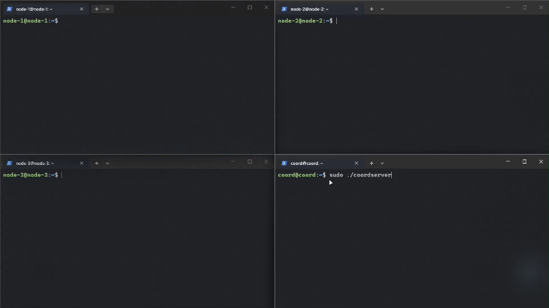
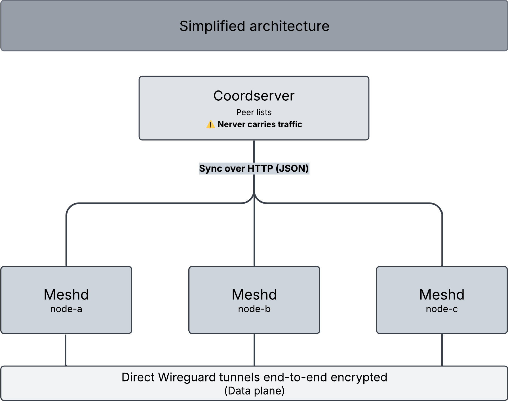

<p align="center">
  
</p>

<p align="center">
  <a href="#license"></a>
  
  
  
  
  
</p>
---

Knoten connects your machines (servers, cloud instances, VMs, laptops) over **direct, end-to-end encrypted WireGuard tunnels**, instead of funnelling every packet through one central VPN server.

A coordination server may exist, but it only handles **discovery, identity, and address assignment**. It never carries your data.

<p align="center">
  
</p>

*This demo was recorded with the previous version (`v0.2.0-alpha`). Using Knoten works the same way; the change is under the hood: `meshd` used to write a WireGuard config file and hand it to the kernel module through `wg` and `wg-quick`, and now it runs WireGuard itself through an embedded [wireguard-go](https://pkg.go.dev/golang.zx2c4.com/wireguard). Some log lines differ, and stopping `meshd` now removes the tunnel. You can still check the tunnel with `sudo wg show knoten-wg` if `wireguard-tools` is installed.*

> [!IMPORTANT]
> **New: one config file and peer memory.** Each node keeps its settings, its key and its peers in a single file, `/etc/knoten/meshd.json`. Peers from the coordination server are saved there too, so a restarted node has them right away, even while the server is unreachable. A node can use a coordination server, peers you list yourself, or both.

> [!NOTE]
> Status: **Alpha** (latest version `v0.3.1-alpha`)
>
> **Knoten is still in its alpha phase.** The current working version runs: a coordination server, a node daemon, automatic key generation, IP address management, peer memory, and live tunnel updates. 
> **This is a student-driven project under active development**. Command-line flags, the HTTP API, and on-disk formats may still change between versions, without a compatibility guarantee.

> [!IMPORTANT]
> **Knoten does not currently support nodes behind Network Address Translation (NAT)**.

## Contents

- [Why Knoten](#why-knoten)
- [How it works](#how-it-works)
- [Ways to run it](#ways-to-run-it)
- [Requirements](#requirements)
- [Quick start](#quick-start)
  - [With a coordination server](#with-a-coordination-server)
  - [Without a server](#without-a-server)
- [The config file](#the-config-file)
- [Command-line reference](#command-line-reference)
- [Files and paths](#files-and-paths)
- [Security model](#security-model)
- [Roadmap](#roadmap)
- [Contributing](#contributing)
- [License](#license)

## Why Knoten

**Direct peer-to-peer by default.** Traffic goes straight from one machine to another. The coordination layer is consulted only when something needs to change: who exists, who is allowed in, and which address each machine holds.

**Resilient by design.** Tunnels never depend on the coordination layer to stay alive. Existing connections are sustained by WireGuard itself, so losing a coordinator restricts network *administration*, not connectivity. This assumes relatively stable peers; radical, simultaneous changes across the fleet cannot be reconciled until coordination is restored.

**Access is a lease, never a possession.** Every grant is designed to carry an expiry and persist only through renewal. Revocation is simply expiry-now, so removing access is never a special operation, and abandoned access decays to nothing on its own. *(Design principle not yet implemented; the lease mechanism itself is on the [roadmap](#roadmap).)*

**Small and genuinely self-hostable.** Two static Go binaries and one SQLite file. **You can even run the coordserver and meshd binaries on the same machine.**

## How it works

<p align="center">
  
</p>

On each machine, `meshd`:

1. **Has its own identity:** a keypair created locally by `meshd -setup`. The private key is stored in `/etc/knoten/meshd.json` (`0600`) and never leaves the machine.
2. **Registers** with the coordination server, if one is set, which assigns it a stable VPN address out of `10.10.0.0/16` and records the public endpoint it was seen from.
3. **Polls `/v1/sync`** on an interval the server dictates to the whole fleet, receiving the list of peers that have checked in recently.
4. **Applies the peer list** (the server's, plus any peers you listed yourself) to its own WireGuard tunnel, `knoten-wg`, which runs inside `meshd` itself.
5. **Remembers the peers** in `meshd.json`, so after a restart the tunnel comes back with them, even while the server is unreachable.
6. **Stays in the background.** All actual traffic flows peer to peer, encrypted end to end by WireGuard.


**The tunnel lives inside `meshd`: stopping `meshd` removes it, and starting it again brings it back. Run it as a service (for example systemd with `Restart=always`) so it comes back on its own.**

**If the coordination server becomes unreachable, `meshd` keeps the tunnel and its peers as they are, and retries with exponential backoff (1s to 60s, with jitter).**

## Ways to run it

| Setup                          | When to use it                                                                                                                       | What you run                                                                         |
| ------------------------------ | ------------------------------------------------------------------------------------------------------------------------------------ | ------------------------------------------------------------------------------------ |
| **With a coordination server** | Machines have changing IPs, or you don't want to exchange keys by hand.                                                              | `coordserver` on one reachable host, `meshd` on every node. A node can do both jobs. |
| **Without a server**           | Every node has a static, reachable IP address, and you are happy to list peers yourself. Pure peer-to-peer, no control plane at all. | `meshd` on each node, with its peers listed in `meshd.json`.                         |
| **Both**                       | Peers come from the server, plus a ones you list yourself.                                                                           | The same as with a server, plus `static` peers in `meshd.json`.                      |

There are no modes to pick: setting `server_url` in `meshd.json` turns the server on, and peers you list yourself work with or without it.

The coordination server gives machines addresses from a fixed `10.10.0.0/16` range.

## Requirements

- **Linux** on every node, with `/dev/net/tun` available (it is on standard distributions). `meshd` creates the `knoten-wg` interface itself, so it must run as root.

- **One reachable host** for `coordserver`, if you use a coordination server.

## Quick start

Prebuilt Linux binaries are attached to each [release](https://github.com/Yacin1102/Knoten/releases). 

### With a coordination server

This walks through one coordination server plus a fleet of nodes. Skip to [Without a server](#without-a-server) if every node already has a static IP.

#### 1. Start the coordination server

Generate a join token first. Every machine must present it to enrol. (Skip if you don't want a join token)

```bash
sudo mkdir -p /etc/knoten
openssl rand -base64 32 | sudo tee /etc/knoten/token > /dev/null
sudo chmod 600 /etc/knoten/token
```

Create the database directory:
```bash
sudo mkdir /var/lib/knoten
```

Give the binary the right permissions:
```bash
chmod +x ./coordserver
```
Then start the server:

```bash
sudo ./coordserver \
  -token-file /etc/knoten/token #skip if you didn't generate one
```

It should show something like this:

```
coordserver: listening on :8080 (plain HTTP)
coordserver: VPN range: 10.10.0.0/16
coordserver: database:  /var/lib/knoten/coord.db
coordserver: machines poll every 30s; considered gone after 1m30s of silence
coordserver: join token is set (44 characters)
```

The database file and its directory are created if missing. Open TCP **8080** on the coordination server, and UDP **51820** (the WireGuard port) on every node.

> ⚠️ `coordserver` speaks **plain HTTP** and has no TLS of its own. Put it behind a reverse proxy that terminates TLS before exposing it to the internet. (*Native HTTPS support is planned for a future version.*) See [Security model](#security-model).

#### 2. Join your first machine
Give the binary the right permissions:
```bash
chmod +x ./meshd
```

Run interactive setup on the node:
```bash
sudo ./meshd -setup
```

Setup asks a short list of questions, writes `/etc/knoten/meshd.json` with a new key for this machine, and prints its public key:

```
ListenPort (default 51820):
Coordination server URL (e.g. https://coord.example.com:8443, leave empty for none): http://<server IP>:8080
Join token (leave empty if the server does not require one): <paste the token from step 1 if you generated one>
Peer PublicKey (leave empty to finish):
Name for this machine (leave empty for "Hostname-01"):
```

Setup stores the token you paste inline in `meshd.json`, as `join_token`. To keep the token in its own file instead, edit `/etc/knoten/meshd.json` after setup and swap the field:

```json
{
  "server_url": "http://198.51.100.10:8080",
  "token_file": "/etc/knoten/token"
}
```

`token_file` wins when both are present: if it is set, `join_token` is ignored entirely. Setup never writes `token_file` for you, so this is always a manual edit.

`-setup` writes the config and exits. Then start `meshd` and keep it running:

```bash
sudo ./meshd
```

> You can run it in the background, or install it as a systemd service.

On its first run it registers and brings the tunnel up:

```
meshd: coordination server: http://198.51.100.10:8080
meshd: this machine: "node-1", public key 9Kx...=
meshd: registering with http://198.51.100.10:8080
meshd: registered: our VPN address is 10.10.0.3/16
meshd: the server sees us at 203.0.113.5:51820
meshd: brought knoten-wg up with address 10.10.0.3/16
meshd: synced knoten-wg: 0 added, 0 updated, 0 removed
```

#### 3. Join the rest of the fleet

Repeat step 2 on every other machine. Each one gets its own key and its own address, and within one sync interval (30s by default) every node sees every other node:

```
meshd: synced knoten-wg: 2 added, 0 updated, 0 removed
```

Each node saves these peers in its `meshd.json`, so after a restart it reconnects right away, even if the server is down.

#### 4. Verify

```bash
# What does the control plane think?
curl -s http://<server IP>:8080/v1/health
# {"status":"ok","machines_total":3,"machines_alive":3,"uptime_seconds":412,
#  "vpn_cidr":"10.10.0.0/16","sync_interval_seconds":30}

# What does WireGuard think? (You will need wireguard tools installed to use this command)
sudo wg show knoten-wg 

# Can you reach a peer over the mesh?
ping 10.10.0.4
```

Send `SIGHUP` to any daemon to re-read its config and sync right away, instead of waiting for the next poll:

```bash
sudo pkill -HUP meshd
```

### Without a server

If every node has a static, reachable address, skip the server entirely. Run `meshd -setup`, leave the server URL empty, then enter this node's address and each peer by hand:

```
Coordination server URL (e.g. https://coord.example.com:8443, leave empty for none):
This machine's VPN address (e.g. 10.0.0.1/24): 10.0.0.1/24

Peer PublicKey (leave empty to finish): xTIBA5rboUvnH4htodjb6e697QjLERt1NAB4mZqp8Dg=
  AllowedIPs (e.g. 10.0.0.2/32, 192.168.1.0/24): 10.0.0.2/32
  Endpoint (e.g. 192.168.56.102:51820) (leave empty if this peer has no fixed address): 203.0.113.7:51820
  Name for this peer (optional): db-01
Peer PublicKey (leave empty to finish):
```

Setup prints this machine's public key at the end, and `meshd -show-key` shows it again later. If you don't have the other machines' keys yet, run setup on every node first with no peers, then add them in `meshd.json` (see [The config file](#the-config-file)).

Start `meshd` on each node and keep it running, since the tunnel lives inside it. Changes to the peer list are picked up within a few seconds, without a restart.

## The config file

Everything a node needs is in `/etc/knoten/meshd.json`. `meshd -setup` writes it; after that you can edit it by hand, and a running `meshd` picks up your changes within a few seconds.

```json
{
  "server_url": "http://198.51.100.10:8080",
  "token_file": "/etc/knoten/token",
  "name": "node-1",
  "listen_port": 51820,
  "persistent_keepalive": 25,
  "private_key": "…",
  "address": "10.10.0.3/16",
  "peers": [
    { "source": "static",  "name": "node-2", "public_key": "Q2v…=", "allowed_ips": ["10.10.0.4/32"], "endpoint": "198.51.100.20:51820" },
    { "source": "synced",  "name": "node-3", "public_key": "m7T…=", "allowed_ips": ["10.10.0.5/32"], "endpoint": "198.51.100.30:51820" },
    { "source": "blocked", "name": "old-laptop", "public_key": "Zr8…=" }
  ]
}
```

| Field                       | Meaning                                                                                                          |
| --------------------------- | ---------------------------------------------------------------------------------------------------------------- |
| `server_url`                | The coordination server URL. Leave it out to run without one.                                                    |
| `join_token` / `token_file` | The server's join token, inline or read from a `0600` file. `token_file` wins if both are set.                   |
| `name`                      | This machine's name, sent to the server when it first joins. Defaults to the hostname.                           |
| `listen_port`               | WireGuard's UDP port. Default `51820`.                                                                           |
| `persistent_keepalive`      | Seconds between keepalives, which keep NAT mappings open. `0` turns them off. Default `25`.                      |
| `mtu`                       | The tunnel's MTU. Leave it out for the default (`1420`).                                                         |
| `private_key`               | This machine's identity. **Back it up:** without it, the machine gets a new identity.                            |
| `address`                   | This machine's VPN address. Required without a server; with one, `meshd` writes the address the server assigned. |
| `peers`                     | The peer list, see below.                                                                                        |

Each peer has a `source`, which says who decides about it:

| `source`  | Written by | Meaning                                                                                          |
| --------- | ---------- | ------------------------------------------------------------------------------------------------ |
| `static`  | **you**    | Always in the tunnel. `meshd` never changes it.                                                  |
| `synced`  | `meshd`    | Received from the coordination server and kept up to date. Edits to these lines are overwritten. |
| `blocked` | **you**    | Never in the tunnel, even if the server sends it. Only `public_key` is needed.                   |

- **List each `public_key` once.** To keep a server peer even after the server drops it, change its `source` to `static`. To keep it out, change it to `blocked`.
- `allowed_ips` is a list of address ranges; use `/32` for a single machine. `endpoint` (`ip:port`) is optional.
- `meshd` writes only its own parts: `address`, the `synced` peers, and `private_key` if it has to create one. Your settings and your `static` and `blocked` peers stay as you wrote them.
- A file with a mistake is reported in the log and left alone. `meshd` keeps the last good settings until you fix it.
- Changes to `server_url`, `join_token`, `token_file`, `mtu` and `private_key` take effect after a restart. Everything else applies within a few seconds.

## Command-line reference

For a quick look without leaving the terminal:

```bash
coordserver -h
meshd -h
```

**Signals:** `SIGHUP` makes `meshd` re-read its config and sync immediately. `SIGINT` and `SIGTERM` stop it cleanly and remove the tunnel.

## Files and paths

| Path                                | Written by    | Mode                          | Contents                                                                                                          |
| ----------------------------------- | ------------- | ----------------------------- | ----------------------------------------------------------------------------------------------------------------- |
| `/etc/knoten/meshd.json`            | `meshd`       | `0600`                        | Settings, private key, VPN address and peers. See [The config file](#the-config-file). **Back this up.**          |
| `/etc/knoten/token`                 | you           | `0600`                        | Shared join token. Read by `coordserver -token-file`, and by `meshd` only when `token_file` is set in its config. |
| `/var/lib/knoten/coord.db`          | `coordserver` | -                             | SQLite database of enrolled machines.                                                                             |
| `/var/run/wireguard/knoten-wg.sock` | `meshd`       | `0600`-equivalent (root only) | WireGuard control socket. Exists while `meshd` runs.                                                              |

> **Deleting `private_key` from `meshd.json` gives the machine a brand-new identity, and with a server a brand-new VPN address.** The old registration lingers on the server until it times out.

The interface is always named `knoten-wg`.

## Security model

**What Knoten protects today**

- **Traffic is end-to-end encrypted by WireGuard**, peer to peer. The coordination server sees metadata: public keys, names, addresses, endpoints, and last-seen times.

- **Private keys never leave the machine.** They are generated locally and stored in `meshd.json`, which `meshd` always writes `0600`. That file _is_ the machine's identity: don't share it, paste it, or commit it.

- **The coordination server is defensive at the edges**: bounded request bodies, strict JSON decoding, request timeouts, panic recovery, and a single-writer SQLite store with `WAL` and `synchronous = FULL`.

- **Each node has the final say over its own tunnel.** A `blocked` peer stays out whatever the server sends, and `static` peers stay even if the server drops them.

**Known limitations**

- **No TLS.** `coordserver` serves plain HTTP. Terminate TLS in front of it (nginx, Caddy, Traffic) before exposing it publicly, and set `-trust-proxy` only when your proxy overwrites `X-Forwarded-For`.

- **One shared token for the whole fleet.** Any machine holding it can enroll and read the peer list. There is no per-machine credential and no revocation yet. See the [roadmap](#roadmap).

- **No NAT traversal.** Endpoints come from whatever address the server observed. Peers behind symmetric NAT with no port forwarding may not reach each other directly, and there is no relay fallback yet.

- **No admin surface yet.** Machines that go silent are hidden from the others after 90 seconds, but stay in the database with their address. Removing one for good means deleting its row from the SQLite database by hand. On each node, you can keep a machine out of the tunnel by changing its `source` to `blocked` in `meshd.json`.

## Roadmap

As a student, I am constantly **learning while building** Knoten. This is the project's planned roadmap:

| Stage | What we’ll be building                                  | Progress | **Details**                                                                                                                                                                                                                                                                            |
| ----- | ------------------------------------------------------- | -------- | -------------------------------------------------------------------------------------------------------------------------------------------------------------------------------------------------------------------------------------------------------------------------------------- |
| 1     | WireGuard config generator \| v0.1                      | ✅        | -                                                                                                                                                                                                                                                                                      |
| 2     | Coordination server \| v0.2.0-alpha                     | ✅        | -                                                                                                                                                                                                                                                                                      |
| 3     | Wg-go + Light optimizations \| v0.3.0-alpha             | ✅        | - **Embed Wireguard into knoten through wg-go package**, replacing the config file writing mechanism.<br>- Replace the current shell-out to `wg` and `wg-quick`.                                                                                                                       |
| 4     | Peer memory & single configuration file \| v0.3.1-alpha | ✅        | - **Remember the last peer list** across restarts, so a node comes back with its peers even while the coordination server is unreachable.<br>- **One configuration file** instead of separate standalone and coordinated modes: a coordination server, manually listed peers, or both. |
| 5     | IPv6 migration \| v0.3.2-alpha                          | 🔨       | - **IPv6 addresses derived from each machine's public key**, so its address follows from its identity.<br>- **No address assignment by the coordination server**, one step towards needing it less.                                                                                    |
| 6     | windows support                                         | -        | -                                                                                                                                                                                                                                                                                      |
| 7     | Relay                                                   | -        | - **Last-resort relay** for peers that genuinely cannot reach each other. (Even then, relayed packets stay sealed and end-to-end encrypted, unreadable by the relay.)                                                                                                                  |
| 8     | NAT support                                             | -        | -                                                                                                                                                                                                                                                                                      |
| 9     | Redundant control-plane coordination                    | -        | - **Multiple coordination servers**, so the control plane has no single point of failure.                                                                                                                                                                                              |
| 10    | Identity & access management                            | -        | - **Per-machine credentials, leases and revocation**, replacing the single shared join token and realising the "access is a lease" principle.                                                                                                                                          |
| 11    | Management console (UI)                                 | -        | -                                                                                                                                                                                                                                                                                      |
| 12    | Hardening                                               | -        | -                                                                                                                                                                                                                                                                                      |


## Contributing

This is a student-driven project, and contributions are genuinely welcome: bug reports, suggestions, design critique, and documentation just as much as code.

Please open an issue to discuss anything substantial before sending a large pull request. Because the project documents its own development journey, PRs that change design decisions are more useful when they explain the reasoning, not only the diff.

Thank you.

## License

Released under the [MIT License](LICENSE).
